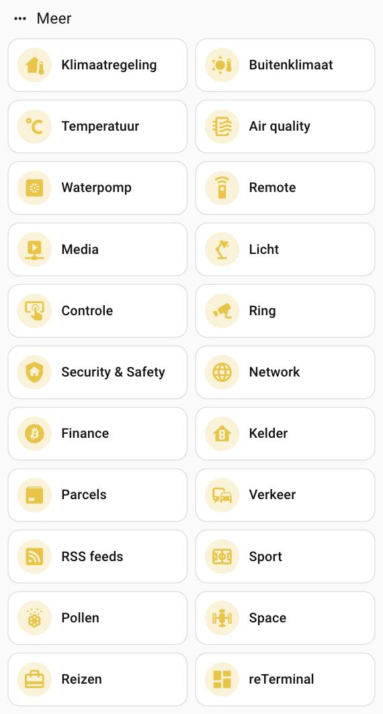

# Meer navigatie card

*[Nederlandse versie](README.nl.md)*

A Home Assistant dashboard card with buttons to every page (views and subviews) of a dashboard, in
the same order as in that dashboard. The card only shows buttons for pages the logged-in user is
allowed to see.



* Follows each page's **Visibility** setting. Give someone access to a page, or take it away, and
  the button appears or disappears by itself. No need to edit the card.
* New pages get a button automatically, in their place in the order.
* The buttons look like regular tile cards and fit in a sections view.
* No dependencies; only the built-in `sun` integration (see [Limitations](#limitations)).

("Meer" is Dutch for "more": the card was built for a "More" section at the bottom of a home page.)

## Installation

### Marketplace (Home Assistant 2026.11 and later)

1. Settings → **Marketplace**, search for **Meer navigatie card** and open it.
2. Select **Install** and confirm. The Marketplace adds the dashboard resource for you.
3. Reload your browser.

The first time you install from the Marketplace, you are asked to accept that community content is
not reviewed by Home Assistant. If your dashboard resources are managed in YAML, the install dialog
shows the resource line to add yourself.

Installed the card with HACS before? Home Assistant moves it to the Marketplace automatically when
it starts after the update; you don't need to do anything.

### HACS (Home Assistant 2026.10 and older)

Open HACS, search for **Meer navigatie card**, download it and refresh your browser.

### Manual

1. Download `meer-navigatie-card.js` and put it in `/config/www/`.
2. Settings → Dashboards → ⋮ → **Resources** → add
   `/local/meer-navigatie-card.js?v=1.0.3`, type **JavaScript module**.
3. Refresh your browser. Raise `?v=` with every new version.

## Configuration

```yaml
type: custom:meer-navigatie-card
```

| Option      | Default | Description |
|-------------|---------|-------------|
| `dashboard` | `null`  | URL path of the dashboard whose pages are listed. `null` is the default dashboard (`/lovelace`). |
| `exclude`   | `[]`    | Paths of pages that get no button, for example the page the card itself is on. |
| `names`     | `{}`    | Different button name per page title, for example `{Lights_Sections: Lights}`. |
| `extra`     | `[]`    | Your own buttons: `{after, name, icon, path}`. The button is placed right after the page with path `after`. |
| `columns`   | `2`     | Number of buttons per row. |

### Example: collapsible "More" section

Uses an `input_boolean` helper (here `input_boolean.dashboard_more_open`) and standard visibility
conditions. Select the heading to expand or collapse.

```yaml
type: grid
cards:
  - type: heading
    heading: More
    icon: mdi:dots-horizontal
    tap_action:
      action: perform-action
      perform_action: input_boolean.toggle
      target:
        entity_id: input_boolean.dashboard_more_open
  - type: custom:meer-navigatie-card
    exclude:
      - home
    names:
      Lights_Sections: Lights
    extra:
      - after: home
        name: Home (extra)
        icon: mdi:map-marker-path
        path: /lovelace/home-extra
    visibility:
      - condition: state
        entity: input_boolean.dashboard_more_open
        state: "on"
```

Note: a helper has one state for everyone. If one person expands the section, it is expanded for
everybody else too.

To collapse the section again automatically after a while, add an automation. Set the time under
`for` (here 2 minutes):

```yaml
alias: Collapse "More" section
triggers:
  - trigger: state
    entity_id: input_boolean.dashboard_more_open
    to: "on"
    for:
      minutes: 2
actions:
  - action: input_boolean.turn_off
    target:
      entity_id: input_boolean.dashboard_more_open
mode: single
```

The timer restarts every time the section is expanded. If Home Assistant restarts while the
section is open, the timer is lost and the section stays open until someone collapses it.

## How it works

When the page opens, the card reads the dashboard configuration (`lovelace/config`, which every
logged-in user may read). For each page it looks at `visible`:

* no `visible`: everyone sees the button;
* a list of users: only those users see the button;
* `visible: false`: nobody sees the button.

After the dashboard is saved (`lovelace_updated`) the card reloads.

## Limitations

* The buttons are tile cards with `sun.sun` as their entity, because a tile needs an entity. The
  state is hidden; only the icon colour follows the sun (active by day, dimmed at night).
* The card only hides buttons. Anyone who knows a page's address can still open it. Visibility in
  Home Assistant is not a security feature.

## Development

The code follows the
[coding guidelines of the Home Assistant frontend](https://contributors.home-assistant.io/frontend/development/guidelines/)
and the page on [custom cards](https://contributors.home-assistant.io/frontend/custom-ui/card/),
with the same Prettier and ESLint rules (`.prettierrc.json`, `eslint.config.mjs`). The GitHub
action checks them on every push; with Node you can run the check yourself:

```bash
npm install --no-save --no-package-lock prettier@3.10.1 eslint@10.15.0 @eslint/js@10.0.1
npx prettier --check meer-navigatie-card.js eslint.config.mjs
npx eslint meer-navigatie-card.js
```

To see which version your browser loaded, run
`customElements.get("meer-navigatie-card").version` in the browser console.

## License

MIT, see [LICENSE](LICENSE).
